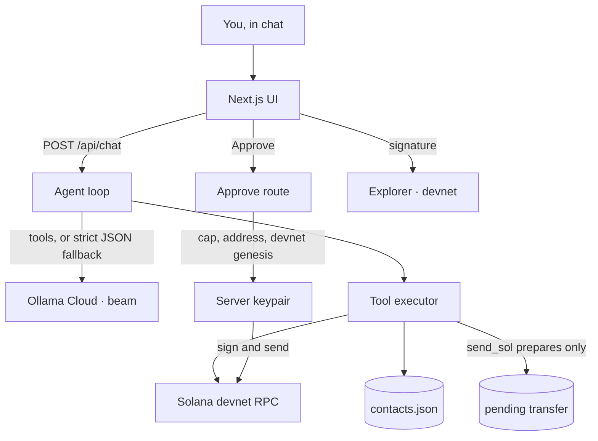

# Solana Pay Agent

Chat in English or Indonesian to check a Solana devnet wallet, save contacts, and send SOL — nothing is signed until you tap Approve.

## Problem

Wallets still speak in addresses, signatures, and raw transfers. People paste the wrong string, and an agent that can sign is one prompt away from sending funds. Solana Pay Agent is a payments assistant you can talk to, with signing taken out of the model's hands.

## What it does

- Answers in the language you used (English or Bahasa Indonesia).
- Checks the server wallet's devnet balance.
- Lists recent transactions and explains a signature in plain language.
- Saves contacts (`save BQiS…VyHA as Budi`) and sends to a name later.
- Prepares a SOL transfer as a confirmation card: recipient, amount, **devnet**, estimated fee, Approve / Cancel.
- Signs and broadcasts **only** after Approve, then shows the signature with a [Solana Explorer](https://explorer.solana.com) devnet link.

Devnet only. If the balance is 0, the header links to [faucet.solana.com](https://faucet.solana.com).

## How it works



1. The browser sends the chat transcript to `POST /api/chat`. The server adds a system prompt (wallet address, contacts, cap, devnet) and calls `POST {LLM_BASE_URL}/api/chat` with `Authorization: Bearer $OLLAMA_API_KEY`, `model` (default `beam`), `tools`, and `stream: false`.
2. If `message.tool_calls` is present, those calls run. Arguments may be objects or JSON strings; both are accepted.
3. If there are no tool calls, the server parses a strict JSON action from the text (`{"action":"send_sol","arguments":{...}}` or `{"action":"reply","message":"..."}`). If that isn't there either, it asks the model once more for JSON (`format: "json"`) and parses that.
4. `get_balance`, `get_recent_transactions`, `save_contact`, `list_contacts`, and `explain_transaction` run immediately. `send_sol` only writes a pending transfer. There is no tool that signs.
5. `POST /api/transfers/:id/approve` re-checks the address and the cap, locks the record so a double-click cannot send twice, checks the RPC genesis hash is devnet, then signs. Cancel never signs.

## Safety model

- **The model cannot sign.** Prompt injection can ask for a transfer. It cannot broadcast one. Signing happens on the Approve route, not inside a tool.
- **You see the payment first.** The card shows the full recipient address, amount, network, and estimated fee.
- **Per-transfer cap.** `MAX_SOL_PER_TRANSFER` (default 1 SOL). Over-cap amounts never become a card, and a tampered pending record fails on approve.
- **Addresses are checked** before a card is stored and again before broadcast. Contact names resolve to the address that was saved.
- **Devnet lock.** Known mainnet/testnet RPC URLs are rejected at startup. Immediately before signing, the server requires genesis hash `EtWTRABZaYq6iMfeYKouRu166VU2xqa1wcaWoxPkrZBG`. Anything else is refused.
- **One broadcast per id.** Status moves `pending → submitting → confirmed|failed`. A second approve of a confirmed transfer does not send again.
- **Keys are not logged.** Errors from the LLM redact `OLLAMA_API_KEY`. `.gitignore` excludes `.env*`, keypair JSON, and contact data.

This stops the agent from moving money on its own. It is not authentication. Run it locally; anyone who can reach the server can also press Approve.

## Tech stack

Next.js (App Router) · TypeScript · Tailwind CSS · `@solana/web3.js` · Ollama Cloud (`beam`) · Vitest

The LLM provider is `src/lib/llm/provider.ts`. Point `LLM_BASE_URL` / `LLM_MODEL` at another Ollama-compatible host without changing the tools.

## Setup

```bash
npm install
cp .env.example .env
# put your Ollama Cloud key in OLLAMA_API_KEY
npm run dev
```

Open [http://localhost:3000](http://localhost:3000). The UI is laid out for a 1280×800 recording.

If `AGENT_SECRET_KEY` and `AGENT_KEYPAIR_PATH` are both empty, the server writes `data/agent-keypair.json` (mode `0600`) and shows that address. Fund it on devnet, then ask the agent for a balance.

### Environment

| Variable | Default | Purpose |
| --- | --- | --- |
| `OLLAMA_API_KEY` | — | Bearer token for Ollama Cloud. Required to chat. Never committed. |
| `LLM_BASE_URL` | `https://ollama.com` | Chat API origin. The app calls `{base}/api/chat`. |
| `LLM_MODEL` | `beam` | Model name. |
| `SOLANA_RPC_URL` | `https://api.devnet.solana.com` | Devnet RPC. URLs containing `mainnet` or `testnet` are rejected. |
| `AGENT_SECRET_KEY` | — | JSON array of the 64-byte secret key. |
| `AGENT_KEYPAIR_PATH` | — | Path to a Solana CLI keypair JSON file. |
| `MAX_SOL_PER_TRANSFER` | `1` | Per-transfer cap, in SOL. |
| `CONTACTS_PATH` | `data/contacts.json` | Saved contacts. |
| `PENDING_TRANSFERS_PATH` | `data/pending-transfers.json` | Prepared transfers. |

### Scripts

| Command | What it does |
| --- | --- |
| `npm run dev` | Next.js dev server. |
| `npm run build` | Production build. |
| `npm test` | Unit tests. LLM and RPC are mocked. |
| `npm run smoke:llm` | One live chat turn with tools. Prints whether native `tool_calls` came back. Does not print the key. |
| `npm run integration:devnet` | Real devnet round-trip (save contact, 0.001 SOL back to the same wallet, approve, fetch). Skips with exit 0 when no key is configured or the balance is under 0.002 SOL. |

## Tests

Vitest covers:

- action parsing (raw JSON, fences, Ollama `tool_calls`, reply actions)
- address and amount validation, the spending cap, and the devnet genesis lock
- the provider request shape (Bearer token, `stream: false`, string arguments) and key redaction
- native tool calls, JSON-in-content, and the strict JSON fallback
- the approve flow: no send until Approve, contact resolution, cancel, over-cap, bad address, insufficient balance, tampered records, off-devnet refusal, and a double submit

## Hackathon fit

**AI track.** The product is a tool-calling agent on Solana, not a chat box in front of a form. It handles two languages, falls back when a model skips native tool calls, and explains transactions in plain language.

**Overall.** The demo is a complete loop — balance, contact, approval card, explorer link, explanation — with the unsafe step (signing) removed from the model. The safety checks are in the server, and the tests lock them in.

## Limitations

- One server keypair, not a connected user wallet. Fine for a devnet demo; not a multi-user app.
- No login. Do not expose the port publicly.
- Contacts and pending transfers are JSON files on disk.
- The fee shown on the card comes from `getFeeForMessage` when the RPC answers, otherwise the standard 5000 lamports for one signature.
- Only the official devnet genesis is allowed, so a private devnet fork will refuse to sign.
- A crash during `submitting` leaves that transfer stuck rather than retrying, so it cannot be sent twice.
- Chat quality depends on `beam` (or whichever `LLM_MODEL` you set) actually calling tools. The JSON fallback covers misses; `npm run smoke:llm` shows what the live model does.
